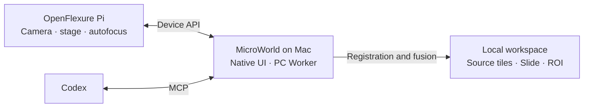

# MicroWorld

**A native macOS workspace for OpenFlexure microscopy.**

Find a microscope, move and focus the stage, capture a tiled scan, then mark the exact region you want to revisit or analyze. MicroWorld brings the live camera, stage controls and Slide viewer into one app. The Mac runs the bundled PC Worker for Canvas storage, registration and fusion. An optional MCP connection lets Codex start a scan and work with the ROI you marked.

[Download Mac and Pi packages](https://github.com/daviddaiiiii/MicroWorld/releases/tag/v0.1.2) · [Install and connect](#install-and-connect) · [Use with Codex](#use-with-codex) · [简体中文](README.zh-CN.md)


*The native Canvas window with an ROI and its source layers. All screenshots use a simulated instrument and a synthetic calibration target.*

## Install and connect

**Requirements.** A Raspberry Pi with a running [OpenFlexure microscope server](https://openflexure.org/projects/microscope/) that exposes the v2 API, sudo access to the Pi, and an Apple silicon Mac running macOS 14 or newer. Connect both devices to the same LAN or a private network such as Tailscale.

### 1. Install on the Pi

Get **MicroWorld-0.1.2-Pi.tar.gz** and **MicroWorld-0.1.2-Pi.tar.gz.sha256** from the [public release](https://github.com/daviddaiiiii/MicroWorld/releases/tag/v0.1.2). Download directly to the Pi or copy the two files from the Mac. With the microscope idle, run on the Pi:

```bash
sha256sum -c MicroWorld-0.1.2-Pi.tar.gz.sha256
tar -xzf MicroWorld-0.1.2-Pi.tar.gz
cd MicroWorld-0.1.2-Pi
sudo ./install-microworld-pi.sh
```

The installer adds the Canvas scan and visual-prompt extensions, backs up any previous versions and restarts OpenFlexure. It keeps the Pi's existing web UI and captures. The [Pi install guide](pi_setup/README.md) covers API checks, custom installations and rollback.

### 2. Install on the Mac

1. Download [MicroWorld-0.1.2-macOS-arm64.zip](https://github.com/daviddaiiiii/MicroWorld/releases/download/v0.1.2/MicroWorld-0.1.2-macOS-arm64.zip). Extract the entire folder to a writable location such as `~/Documents/MicroWorld`. Keep the launchers and `script/` beside `MicroWorld.app`.
2. Open **MicroWorld.app** and allow **Local Network** access. This preview uses ad-hoc signing. If macOS blocks the first launch, follow [Apple's instructions for approving an app](https://support.apple.com/en-us/102445).
3. Select the Pi in **Microscopes** and click **Connect**. If discovery misses it, use **Add by Address** and enter its hostname or IP with port `5000`, for example `microscope.local:5000`. MicroWorld starts its bundled PC Worker when it connects to a Pi with the extensions. For Canvas over LAN or VPN, the Pi must be able to reach the Mac's TCP port `18766` on the private network.

To upgrade, quit the old app and replace `MicroWorld.app` in its existing folder to keep its workspace. The new app identifier is `org.microworld.app`. macOS may ask for Local Network access again. Existing `microworld://` links still use the same scheme.

### 3. Try a first scan

In **Navigate**, confirm clearance between the objective and sample before testing a small jog. Then open **Observe → New Scan**, choose **2 × 2**, and start. Watch the four source tiles arrive and open **Slide** once Mac refinement finishes. Open the saved scan later from **Gallery**.

## Inside the app

### Observe · Live camera and acquisition

See the current field, run Fast AF, capture a snapshot, mark an ROI, or start a fixed-grid or Full scan. On supported Pis, continuous row acquisition selects usable frames and stops to recapture fields that need it.


### Navigate · Stage and focus

Jog XYZ on screen, use the arrow keys for XY and Page Up / Page Down for Z, or enter a destination. The camera stays visible beside the stage controls.


### Canvas · Source tiles, Slide and ROI

Switch between the individual **Tiles** and the registered **Slide**. Inspect and adjust tile layers, zoom into the Slide, or use **Mark ROI** to capture a region with its Canvas context. **Gallery** reopens saved scans and snapshots. **Capture** and **Settings** cover acquisition and camera–stage calibration.

## Use with Codex

1. Connect to a microscope with the MicroWorld Pi extensions installed. From the app menu, choose **Open Codex** if the Codex CLI is installed, or open the MicroWorld folder in a Codex client that loads project MCP settings.
2. Ask Codex to **“Scan 2 × 2 and open the refined Slide.”** The MCP actions are `microworld_scan_2x2` and `microworld_scan_status`. Open the returned `microworld://slide/…` link in the app, or open the HTTP viewer link and choose **Open in MicroWorld**.
3. Choose **Mark ROI** in the Slide, draw a target and wait for the selection confirmation. Return to the same conversation and ask Codex to inspect or quantify the region. The MCP action `microworld_get_slide_roi` returns the crop and its geometry.

The MCP session is tied to the selected microscope. After switching devices, start a new session. Analysis and conversation use your existing Codex environment. Segmentation and counting are performed by the agent with tools appropriate to the sample.

## Where it runs and where data goes



The app creates `Workspace/<device-id>/` beside the app for canvases and captures. It stores local MCP activity and Codex CLI data under `ConversationHistory/<device-id>/` and connection state and logs under `State/` and `Logs/`.

## Build from source

On Apple silicon, install the Xcode Command Line Tools, Node.js with npm, and Python 3. Then run:

```bash
git clone https://github.com/daviddaiiiii/MicroWorld.git
cd MicroWorld
./script/build_app.sh
open MicroWorld.app
```

The build packages the SwiftUI app, Python runtime and PC Worker, MCP server and browser Slide viewer. To package the Pi extensions from this checkout, run `./script/build_pi_release.sh 0.1.2`. For source attribution see [NOTICE.md](NOTICE.md). The desktop layout draws on [openUC2 ImSwitch](https://github.com/openUC2/ImSwitch) and [Apple's macOS interface guidelines](https://developer.apple.com/design/human-interface-guidelines/designing-for-macos).
