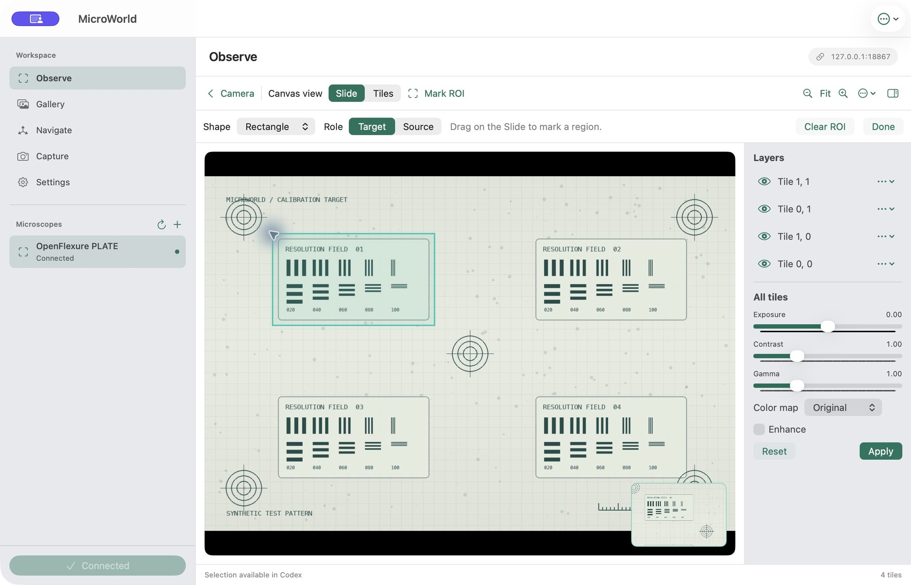
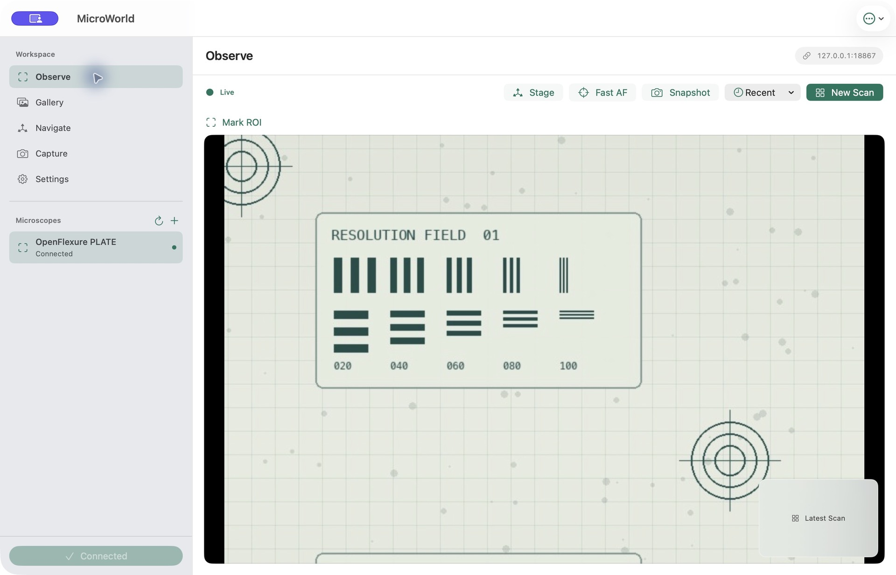
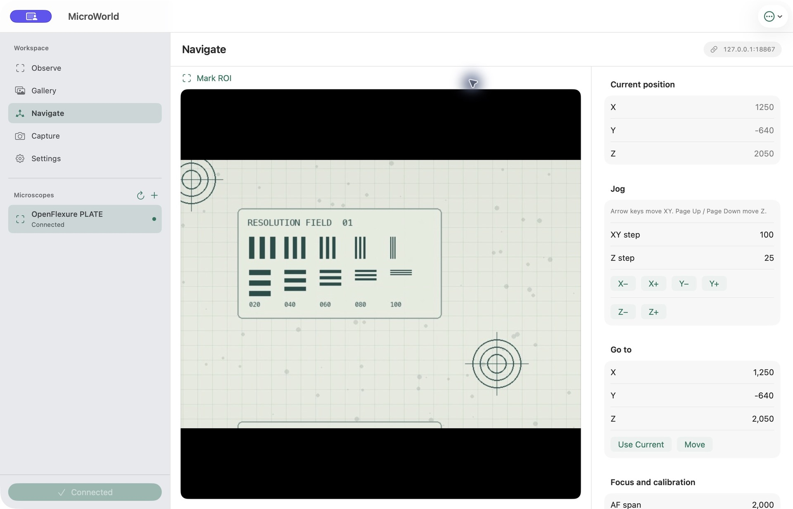
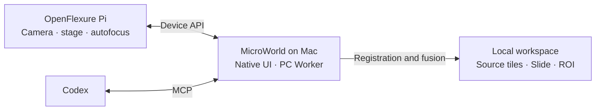

# MicroWorld

**A native macOS workspace for OpenFlexure microscopy.**

Find a microscope, move and focus the stage, capture a tiled scan, then mark the exact region you want to revisit or analyze. MicroWorld brings the live camera, stage controls and Slide viewer into one app. The Mac runs the bundled PC Worker for Canvas storage, registration and fusion. An optional MCP connection lets Codex start a scan and work with the ROI you marked.

[Download for macOS](https://github.com/daviddaiiiii/MicroWorld/releases/tag/v0.1.0) · [Install and connect](#install-and-connect) · [Use with Codex](#use-with-codex) · [简体中文](README.zh-CN.md)



*The native Canvas window with an ROI and its source layers. All screenshots use a simulated instrument and a synthetic calibration target.*

## Install and connect

**Requirements.** An Apple silicon Mac running macOS 14 or newer, plus a reachable [OpenFlexure microscope](https://openflexure.org/projects/microscope/). Use the same local network or a private network such as Tailscale.

1. **Download and extract.** On the [v0.1.0 release page](https://github.com/daviddaiiiii/MicroWorld/releases/tag/v0.1.0), download **MicroWorld-0.1.0-macOS-arm64.zip**. Extract the entire folder to a writable location, such as `~/Documents/MicroWorld`. Keep the launchers and `script/` next to `MicroWorld.app`.
2. **Open the app.** Double-click **MicroWorld.app** and allow **Local Network** access when macOS asks. This preview is ad-hoc signed. If macOS blocks the first launch, follow [Apple's instructions for approving an app](https://support.apple.com/en-us/102445).
3. **Connect the microscope.** Select it in **Microscopes** and click **Connect**. Discovery uses Bonjour, the local network and an installed, connected Tailscale client. Outside the local discovery range, choose **Add by Address** and enter the Pi address, such as `microscope.local:5000`. The app groups addresses by device ID so you can distinguish multiple microscopes.
4. **Try the camera and stage.** Open **Navigate**. Confirm objective and sample clearance, then make one small jog. The position fields show stage steps. Use a calibrated mapping for physical measurements.
5. **Try a Canvas.** With a compatible **OpenMHS Pi extension** installed, open **Observe → New Scan**, choose **2 × 2**, and start the scan. Watch the source tiles arrive, then open **Slide** for the registered image. Saved scans are available in **Gallery**.

> [!NOTE]
> Stock OpenFlexure provides the camera and stage APIs. Canvas scanning, the PC refinement pipeline and ROI handoff require a compatible OpenMHS installation on the Pi. The [OpenMHS Pi setup guide](https://github.com/daviddaiiiii/OpenMHS/blob/main/packaging/pi_setup/README.md) currently requires access to that separate repository. The MicroWorld download bundles the Mac-side Worker and MCP server. For Canvas over a VPN, the Pi must also be able to reach the Mac on TCP port `18766` within the private network.

## Inside the app

### Observe · Live camera and acquisition

See the current field, run Fast AF, capture a snapshot, mark an ROI, or start a fixed-grid or Full scan. On supported Pis, continuous row acquisition selects usable frames and stops to recapture fields that need it.



### Navigate · Stage and focus

Jog XYZ on screen, use the arrow keys for XY and Page Up / Page Down for Z, or enter a destination. The camera stays visible beside the stage controls.



### Canvas · Source tiles, Slide and ROI

Switch between the individual **Tiles** and the registered **Slide**. Inspect and adjust tile layers, zoom into the Slide, or use **Mark ROI** to capture a region with its Canvas context. **Gallery** reopens saved scans and snapshots. **Capture** and **Settings** cover acquisition and camera–stage calibration.

## Use with Codex

1. Connect an OpenMHS microscope in MicroWorld. From the app menu, choose **Open Codex** if the Codex CLI is installed, or open the MicroWorld folder in a Codex client that loads project MCP settings.
2. Ask Codex to **“Scan 2 × 2 and open the refined Slide.”** The MCP actions are `microworld_scan_2x2` and `microworld_scan_status`. Open the returned `microworld://slide/…` link in the app, or open the HTTP viewer link and choose **Open in MicroWorld**.
3. Choose **Mark ROI** in the Slide, draw a target and wait for the selection confirmation. Return to the same conversation and ask Codex to inspect or quantify the region. The MCP action `microworld_get_slide_roi` returns the crop and its geometry.

The MCP session is tied to the selected microscope. After switching devices, start a new session. Analysis and conversation use your existing Codex environment. Segmentation and counting are performed by the agent with tools appropriate to the sample.

## Where it runs and where data goes



The app creates `Workspace/<device-id>/` beside the app for canvases and captures. It stores local MCP activity and Codex CLI data under `ConversationHistory/<device-id>/` and connection state and logs under `State/` and `Logs/`.

## Build from source

On Apple silicon, install the Xcode Command Line Tools, Node.js with npm, and Python 3. Then run:

```bash
git clone https://github.com/daviddaiiiii/MicroWorld.git
cd MicroWorld
./script/build_app.sh
open MicroWorld.app
```

The build packages the SwiftUI app, Python runtime and PC Worker, MCP server and browser Slide viewer. For source attribution see [NOTICE.md](NOTICE.md). The desktop layout draws on [openUC2 ImSwitch](https://github.com/openUC2/ImSwitch) and [Apple's macOS interface guidelines](https://developer.apple.com/design/human-interface-guidelines/designing-for-macos).
