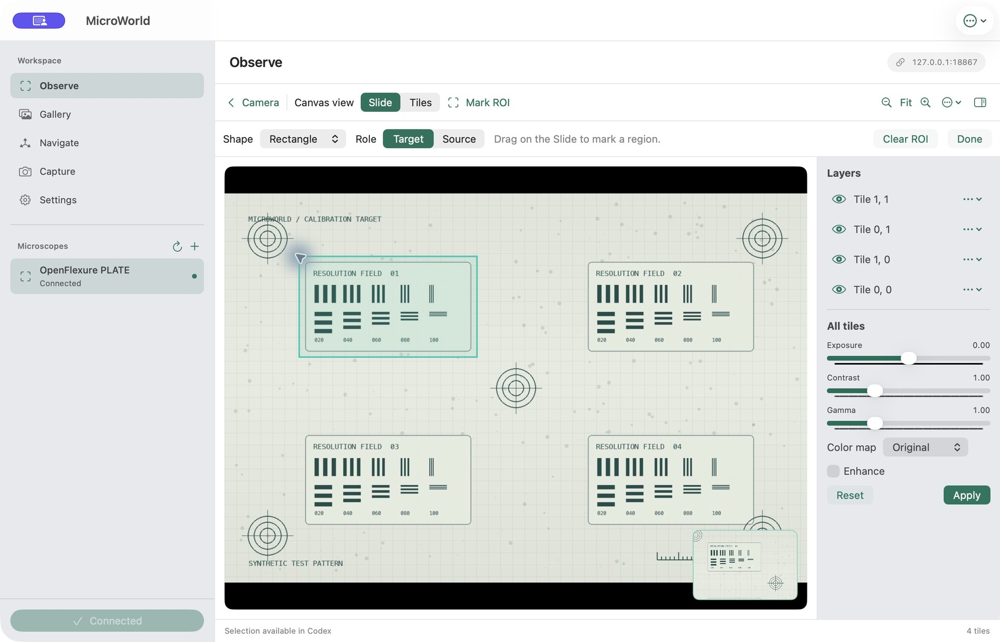
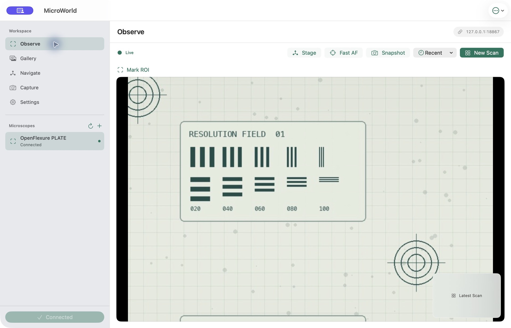

# MicroWorld

**面向 OpenFlexure 显微镜的原生 macOS 工作台。**

在一个窗口里找设备、看实时画面、控制载物台、扫描画布，再圈出要复拍或分析的 ROI。随 App 打包的 PC Worker 在 Mac 上保存 Canvas、配准和融合图像。接入 MCP 后，可以在 Codex 对话里发起扫描，再接着分析你在 App 里标出的区域。

[下载 macOS 版](https://github.com/daviddaiiiii/MicroWorld/releases/tag/v0.1.0) · [安装和连接](#安装和连接) · [配合 Codex 使用](#配合-codex-使用) · [English](README.md)



*截图来自真实的原生 App，使用模拟设备及合成标定图。*

## 安装和连接

**准备条件。** Apple Silicon Mac，macOS 14 或更新版本，以及一台可访问的 [OpenFlexure 显微镜](https://openflexure.org/projects/microscope/)。Mac 和显微镜可在同一局域网，也可通过 Tailscale 等私有网络互连。

1. **下载并解压。** 在 [v0.1.0 发布页](https://github.com/daviddaiiiii/MicroWorld/releases/tag/v0.1.0) 下载 **MicroWorld-0.1.0-macOS-arm64.zip**。解压到有写入权限的位置，例如 `~/Documents/MicroWorld`。启动脚本和 `script/` 与 `MicroWorld.app` 放在同一目录。
2. **打开 App。** 双击 **MicroWorld.app**，按提示允许访问本地网络。这个预览版使用临时签名。如果 macOS 拦截首次启动，按 [Apple 的操作说明](https://support.apple.com/zh-cn/102445)批准打开。
3. **连接设备。** 在 **Microscopes** 里选中设备，点 **Connect**。自动发现支持 Bonjour、局域网和已连接的 Tailscale。也可用 **Add by Address** 手动输入，例如 `microscope.local:5000`。同一台显微镜的多个地址会按设备 ID 合并。
4. **验证相机和载物台。** 打开 **Navigate**。确认镜头与样品的间隙后，先试一次小步移动。坐标栏显示电机步数，物理尺寸请以标定结果为准。
5. **试扫一张画布。** Pi 已安装兼容的 **OpenMHS 扩展**时，在 **Observe → New Scan** 选 **2 × 2** 并启动。采集时可见源图块逐块出现，完成后切到 **Slide** 查看配准结果。已保存结果可在 **Gallery** 里打开。

> [!NOTE]
> 标准 OpenFlexure 提供相机和载物台 API。Canvas 扫描、PC 精拼和 ROI 交接需要 Pi 端的 OpenMHS 扩展。[Pi 安装指南](https://github.com/daviddaiiiii/OpenMHS/blob/main/packaging/pi_setup/README.md)目前需要单独的 OpenMHS 仓库访问权限。MicroWorld 下载包已包含 Mac 端 Worker 和 MCP。通过 VPN 使用 Canvas 时，Pi 还需要能在私有网络内访问 Mac 的 TCP `18766` 端口。

## App 界面

### Observe · 实时相机和采集

实时查看视野，运行 Fast AF、拍快照、标记 ROI，或发起固定网格和 Full 扫描。支持连续采集的 Pi 可沿扫描行选帧，并停下来补拍需要重拍的位置。



### Navigate · 载物台和对焦

保持相机画面可见，用按钮点动 XYZ，或用方向键移动 XY、用 Page Up / Page Down 移动 Z。**Go to** 支持直接输入目标坐标。


### Canvas · 图块、拼接图和 ROI

在 **Tiles** 和 **Slide** 间切换，查看和调整图层，放大观察拼接图，并用 **Mark ROI** 圈出目标。**Gallery** 用于重开历史扫描和快照。采集和相机–载物台标定设置位于 **Capture** 和 **Settings**。

## 配合 Codex 使用

1. 在 MicroWorld 连接已安装 OpenMHS 的显微镜。如已安装 Codex CLI，从菜单选择 **Open Codex**，也可在会读取项目 MCP 配置的 Codex 客户端中打开 MicroWorld 目录。
2. 在对话里说 **“扫一张 2 × 2，打开拼接好的 Slide”**。对应 MCP 工具为 `microworld_scan_2x2` 和 `microworld_scan_status`。点击返回的 `microworld://slide/…` 链接，或从 HTTP 查看器选择 **Open in MicroWorld**。
3. 在 Slide 里点 **Mark ROI**，圈出目标区域并等待确认，再回原对话让 Codex 查看或分析。MCP 工具 `microworld_get_slide_roi` 会返回 ROI 裁图和坐标信息。切换显微镜后需要开启新的 MCP 会话。

App 同目录下的 `Workspace/<device-id>/` 存放 Canvas 和采集结果，`ConversationHistory/<device-id>/` 存放对应设备的 MCP 活动和通过启动器打开的 Codex CLI 数据。连接状态和日志位于 `State/` 与 `Logs/`。

## 从源码构建

在 Apple Silicon Mac 上安装 Xcode Command Line Tools、Node.js 与 npm、Python 3，然后执行：

```bash
git clone https://github.com/daviddaiiiii/MicroWorld.git
cd MicroWorld
./script/build_app.sh
open MicroWorld.app
```

构建包含 SwiftUI App、Python 运行时、PC Worker、MCP 服务及浏览器 Slide 查看器。来源和归属见 [NOTICE.md](NOTICE.md)。
