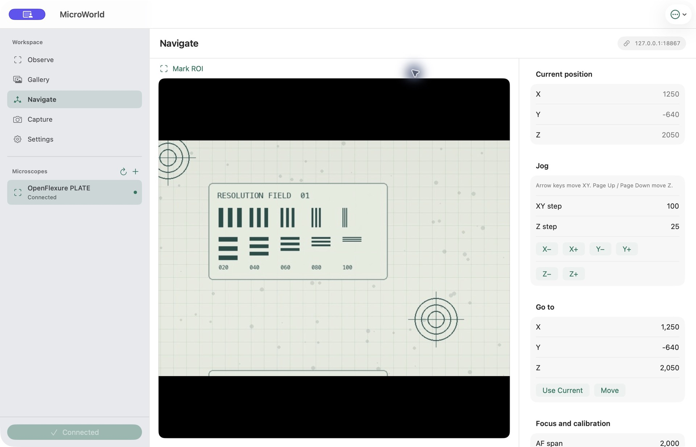

# MicroWorld


**面向 OpenFlexure 显微镜的 macOS 与 Ubuntu 桌面工作台。**

在一个窗口里找设备、看实时画面、控制载物台、扫描画布，再圈出要复拍或分析的 ROI。随 App 打包的 PC Worker 在电脑上保存 Canvas、配准和融合图像。接入 MCP 后，可以在 Codex 对话里发起扫描，再接着分析你在 App 里标出的区域。

[下载 macOS、Ubuntu 和 Pi 安装包](https://github.com/daviddaiiiii/MicroWorld/releases/tag/v0.1.3) · [安装和连接](#安装和连接) · [配合 Codex 使用](#配合-codex-使用) · [English](README.md)


*截图来自真实的原生 App，使用模拟设备及合成标定图。*

## 安装和连接

**准备条件。** Pi 已运行提供 v2 API 的 [OpenFlexure 显微镜服务](https://openflexure.org/projects/microscope/)，并且你有 Pi 的 sudo 权限。电脑可使用 Apple Silicon 的 macOS 14 及以上版本，或 ARM64 的 Ubuntu 24.04。两端可通过局域网或 Tailscale 等私有网络互连。

### 1. 在 Pi 上安装扩展

从[同一个公开 Release](https://github.com/daviddaiiiii/MicroWorld/releases/tag/v0.1.3)下载 **MicroWorld-0.1.3-Pi.tar.gz** 及对应的 **.tar.gz.sha256** 文件。可以在 Pi 上直接下载，也可从 Mac 把两个文件复制到 Pi。等显微镜空闲后，在 Pi 的下载目录执行：

```bash
sha256sum -c MicroWorld-0.1.3-Pi.tar.gz.sha256
tar -xzf MicroWorld-0.1.3-Pi.tar.gz
cd MicroWorld-0.1.3-Pi
sudo ./install-microworld-pi.sh
```

脚本会备份原有扩展，安装 Canvas 扫描和视觉提示接口，重启 OpenFlexure 并检查接口。Pi 原来的网页界面和采集数据会保留。安装成功后记下输出的备份路径。[Pi 安装、核验与回滚说明](pi_setup/README.md)

### 2. 安装电脑端 App

- **macOS** 下载并解压 Mac 安装包，打开 **MicroWorld.app**，按提示允许访问本地网络。[macOS 安装说明](docs/install-macos.md)
- **Ubuntu 24.04 ARM64** 下载 `microworld_0.1.3_arm64.deb`，运行 `sudo apt install ./microworld_0.1.3_arm64.deb`，然后在应用菜单打开 **MicroWorld**。[Linux 安装说明](docs/install-linux.md)

在 **Microscopes** 选择显微镜并连接。两个系统的界面布局略有差异，使用同一套显微镜 API、扫描、配准融合和 MCP 工具。PC Worker 在持有扫描工作区的电脑上运行。Ubuntu 也可以独立启动 [DeepSeek Harness 窗口](docs/install-linux.md#optional-deepseek-harness-window)。

### 3. 试扫一张画布

先确认物镜与样品间有足够间隙，再试一次小步移动。在 macOS 的 **Observe → New Scan** 或 Ubuntu 的 **Live view → Canvas** 选择 **2 × 2** 并启动。采集时观察四个源图块依次出现，PC 完成配准后打开 **Slide** 查看结果。已保存的画布可在 **Gallery** 里重开。

## App 界面

### Observe · 实时相机和采集

实时查看视野，运行 Fast AF、拍快照、标记 ROI，或发起固定网格和 Full 扫描。支持连续采集的 Pi 可沿扫描行选帧，并停下来补拍需要重拍的位置。


### Navigate · 载物台和对焦

保持相机画面可见，用按钮点动 XYZ，或用方向键移动 XY、用 Page Up / Page Down 移动 Z。**Go to** 支持直接输入目标坐标。



### Canvas · 图块、拼接图和 ROI

在 **Tiles** 和 **Slide** 间切换，查看和调整图层，放大观察拼接图，并用 **Mark ROI** 圈出目标。**Gallery** 用于重开历史扫描和快照。采集和相机–载物台标定设置位于 **Capture** 和 **Settings**。

## 配合 Codex 使用

1. 在 App 中连接已安装 MicroWorld Pi 扩展的显微镜。macOS 上如已安装 Codex CLI，从菜单选择 **Open Codex**，也可在会读取项目 MCP 配置的 Codex 客户端中打开 MicroWorld 目录。
2. 在对话里说 **“扫一张 2 × 2，打开拼接好的 Slide”**。对应 MCP 工具为 `microworld_scan_2x2` 和 `microworld_scan_status`。点击返回的 `microworld://slide/…` 链接，或从 HTTP 查看器选择 **Open in MicroWorld**。
3. 在 Slide 里点 **Mark ROI**，圈出目标区域并等待确认，再回原对话让 Codex 查看或分析。MCP 工具 `microworld_get_slide_roi` 会返回 ROI 裁图和坐标信息。切换显微镜后需要开启新的 MCP 会话。

工作区中的 `Workspace/<device-id>/` 存放 Canvas 和采集结果，`ConversationHistory/<device-id>/` 存放对应设备的 MCP 活动和通过启动器打开的 Codex CLI 数据。连接状态和日志位于 `State/` 与 `Logs/`。macOS 上这些目录位于 App 旁边，Ubuntu 上则位于 `~/MicroWorld/`。

## 从源码构建

在 Apple Silicon Mac 上安装 Xcode Command Line Tools、Node.js 与 npm、Python 3，然后执行：

```bash
git clone https://github.com/daviddaiiiii/MicroWorld.git
cd MicroWorld
./script/build_app.sh
open MicroWorld.app
```

构建包含 SwiftUI App、Python 运行时、PC Worker、MCP 服务及浏览器 Slide 查看器。在此仓库运行 `./script/build_pi_release.sh 0.1.3` 可以重新打包 Pi 扩展。来源和归属见 [NOTICE.md](NOTICE.md)。

Ubuntu 可通过 `./script/build_linux.sh` 构建。详见 [Linux 构建说明](docs/install-linux.md#build-from-source)。
